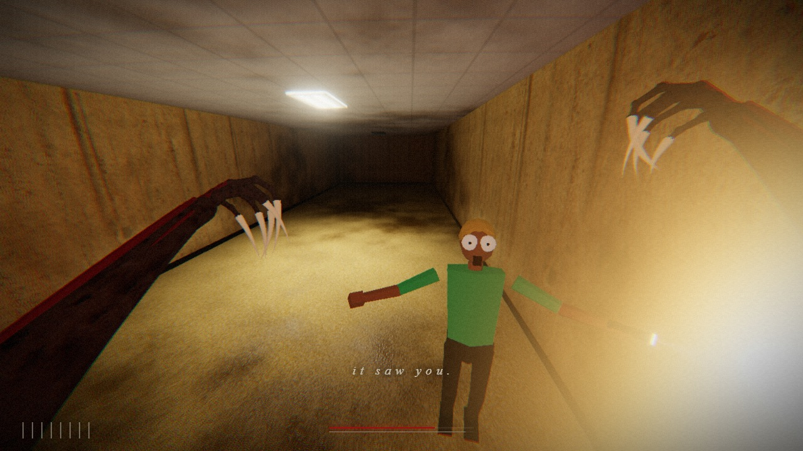
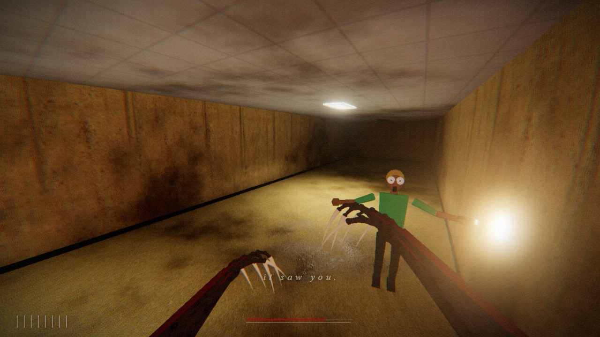
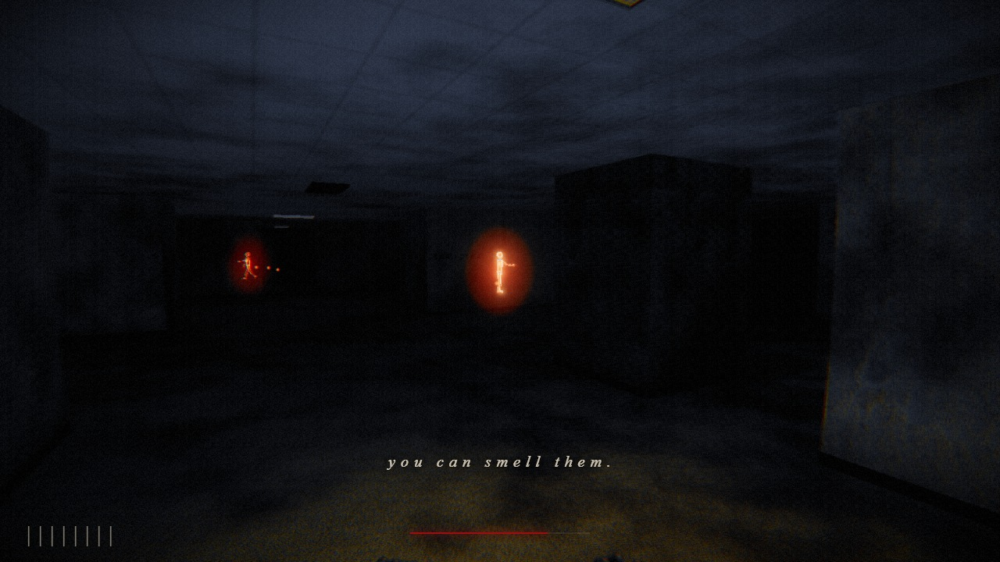

# FEED

A Backrooms horror game where **you are the thing in the rooms**.

They noclipped in with torches and no idea where they are. You were already here, and you are hungry.
Stalk the yellow corridors, smell their body heat through the walls, and catch all eight before you starve.

[](media/feed-gameplay.mp4)

**▶ [Watch the 45 second gameplay video](media/feed-gameplay.mp4)** (recorded from the game itself, see below)

| | |
|---|---|
|  |  |

## Play

```bash
npm install
npm run dev
```

Then open http://localhost:5199 and click to wake. Chrome or Edge on a desktop works best.

| Input | What it does |
|---|---|
| `W A S D` | stalk |
| `Shift` | run them down (burns stamina) |
| `Left click` | lunge and tear |
| hold `Right click` or `E` | smell: the world goes cold and dark, body heat and scent trails glow through walls |
| `R` or `Space` | roar: everyone nearby freezes in terror for a moment, everyone else knows you are coming |
| `1` / `2` | faster / sharper (render resolution) |

The thin red line is your hunger. It drains constantly and only feeding refills it.
The dark hides you: people in lit rooms spot you from much further away than people in the dark,
they hear you when you run, and they warn each other when they scream.

Add `?seed=7` to the URL to get the same building and the same people every time.

## What is in here

Everything 3D is built in code. There are no model files.

- **The building**: a procedurally generated level on a grid, with partitions, doorways and free-standing pillars,
  guaranteed to be fully connected.
- **Lighting**: every fluorescent panel is baked into a light grid on the CPU (with wall occlusion) and sampled in
  a patched `MeshStandardMaterial`, so the whole level is lit for almost nothing. The nearest panels and the nearest
  torches also get real shadow-casting spotlights, handed around from a small fixed pool, so shaders never recompile.
  Some panels are dead, some flicker.
- **Surfaces**: CC0 PBR texture sets (colour, normal, roughness) plus world-space grime, drips and damp patches
  generated in the shader, so no two stretches of wall look alike.
- **The people**: low-poly, built from primitives, animated procedurally. They wander with torches, startle, scream,
  bolt, glance back over their shoulder, flail, get cornered and cower. Their fear is on their faces.
- **You**: clawed arms built from lathes, bent cones and jointed fingers; an invisible body that still casts your
  antlered shadow on the walls; a lens-warped, grainy view of the world.
- **Post**: bloom, chromatic aberration, vignette, film grain, a blood flash when you feed and a cold thermal look
  while you smell.

Performance: the game picks an internal resolution from your GPU (integrated chips get fewer pixels) and lowers it
further if frames run long. `1` and `2` override it.

## The video

`media/feed-gameplay.mp4` (1280×720, 30 fps, 45 s) was filmed by the game. `tools/record.js` is an autopilot that
plays the monster while the simulation is stepped one tick at a time: each kept frame is rendered at 1600×900, scaled
to 1280×720, composited with the HUD and posted to the dev server, and every sound call the game makes is replayed
into an offline mix. ffmpeg then joins the frames and the soundtrack. The comment at the top of that file has the
exact steps. The autopilot stages where the next person is standing so the film keeps its pace; the stalking,
the panic, the roar and the kills are the real game.

## Credits

Code and procedural geometry are original. The assets come from free libraries:

- **Textures**: Poly Haven and ambientCG, all CC0. See [public/assets/textures/CREDITS.md](public/assets/textures/CREDITS.md).
- **Sound effects**: recordings from freesound.org (CC0) and Mixkit (Mixkit Sound Effects Free License).
  Nothing was synthesized. Every file, author and source is listed in
  [public/assets/sfx/CREDITS.md](public/assets/sfx/CREDITS.md). The Mixkit files are included as part of this game;
  if you want them for something else, get them from Mixkit.
- **Engine**: [three.js](https://threejs.org).
